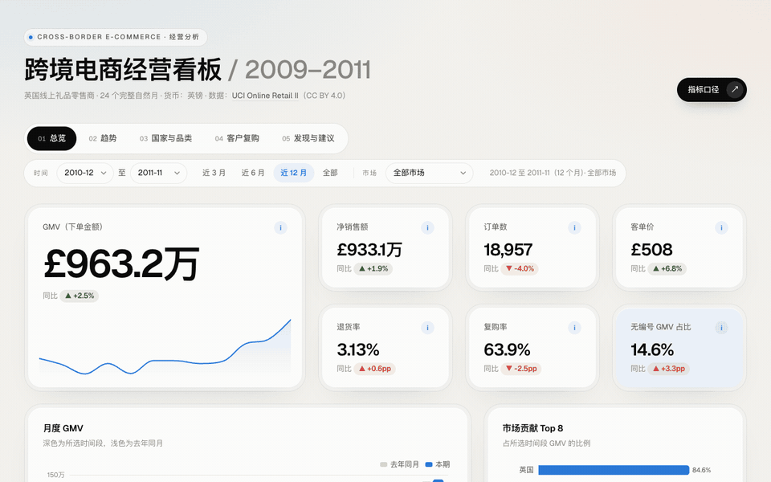
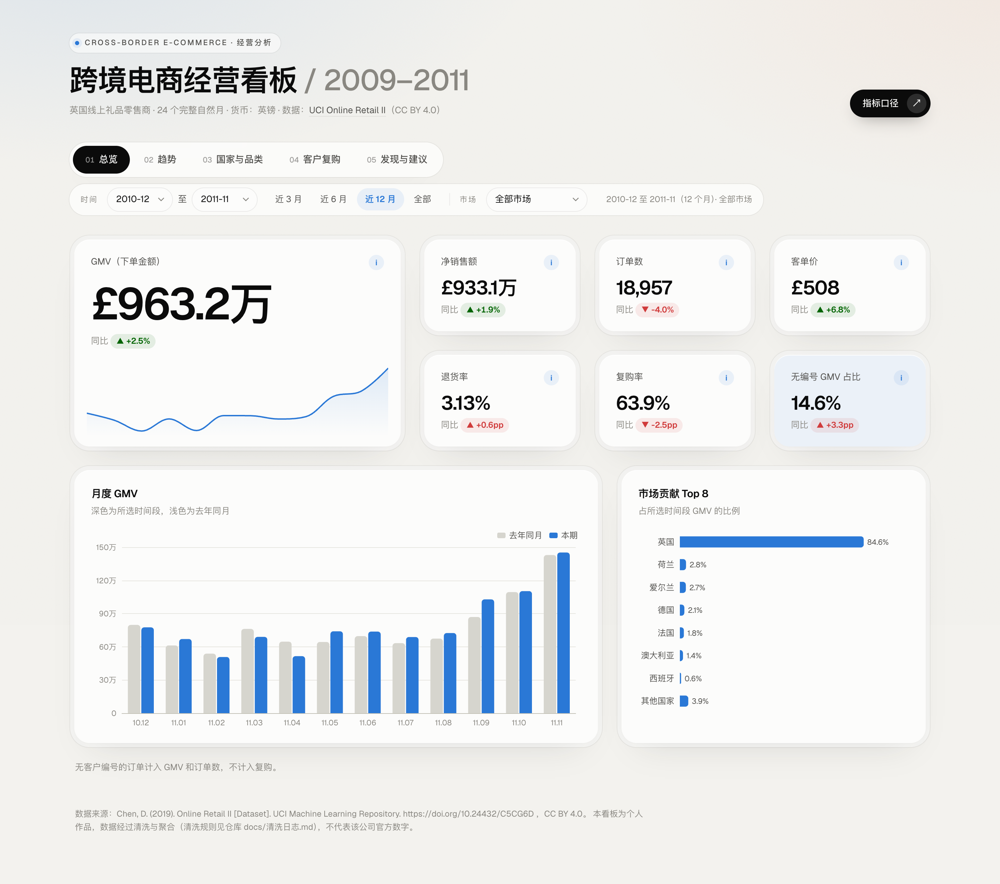
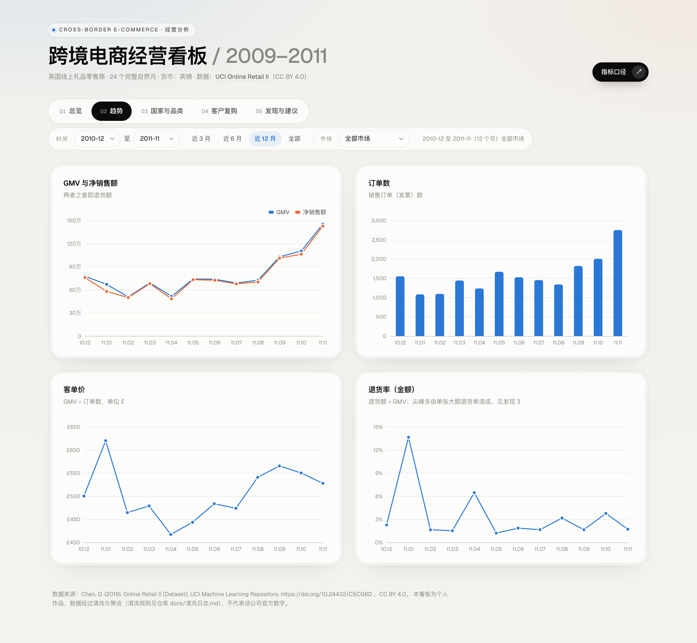
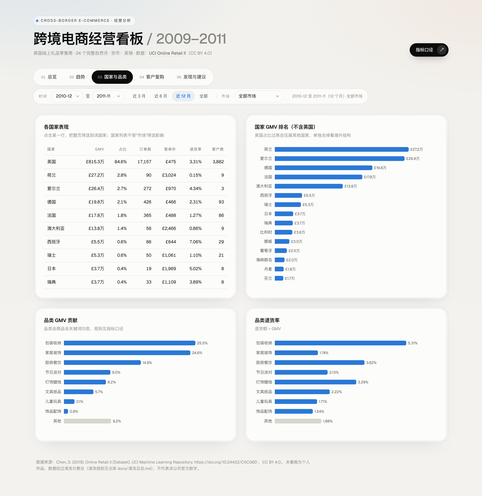
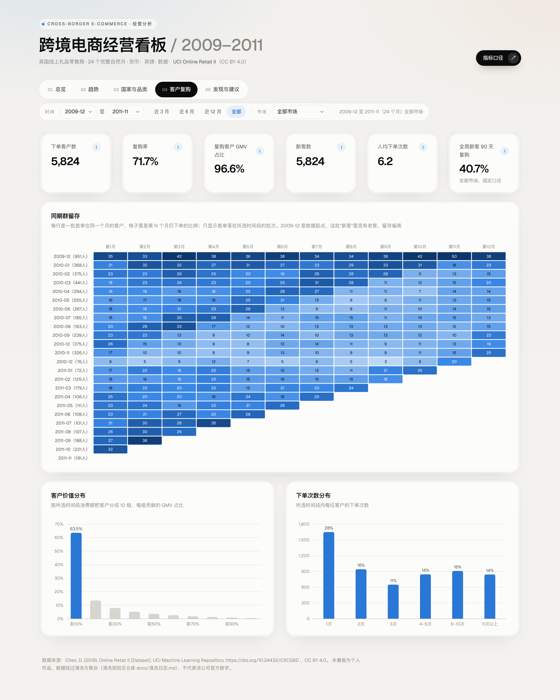
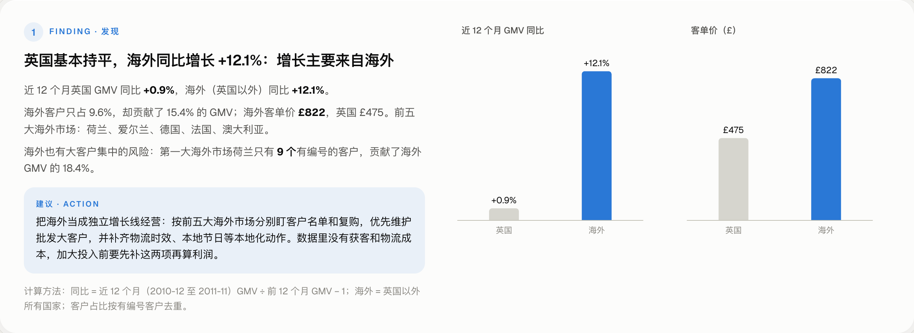
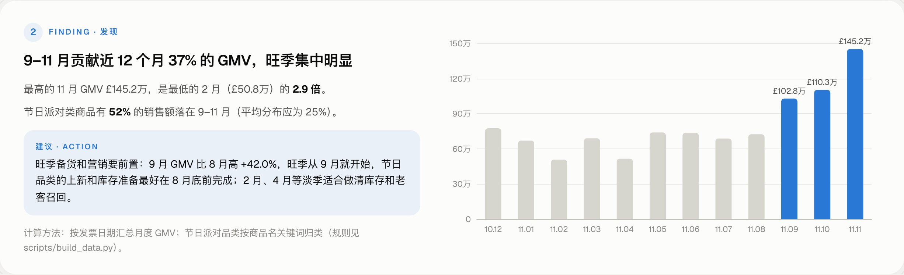
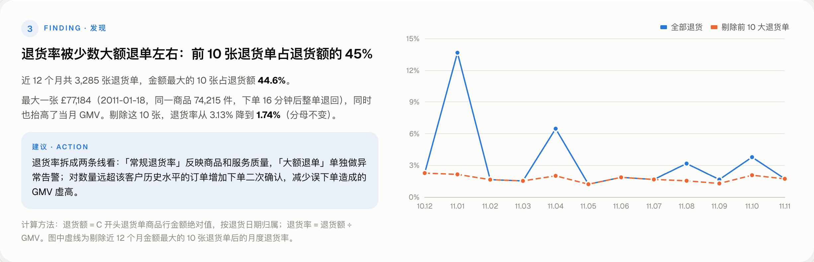
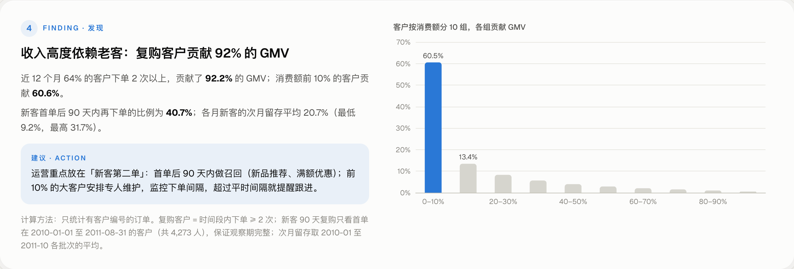
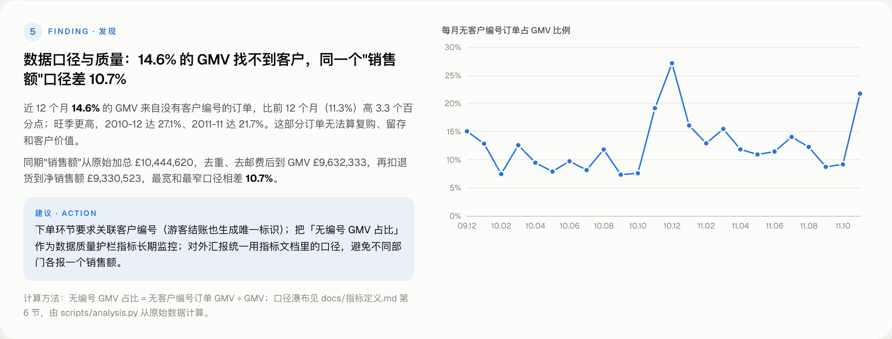

# 跨境电商经营分析看板

**先定指标口径，再做看板。** 用 UCI 公开的英国跨境礼品电商两年交易数据（约 107 万行、40 多个国家），从"经营负责人每周要回答什么问题"出发，定义 GMV、退货率、复购率等指标的口径，再推导出 5 页看板，最后写出 5 条有数据支撑的业务发现和建议。

**在线看板**：https://kennywu411-dev.github.io/ecommerce-dashboard/



## 为什么做这个

问数类 AI 产品里，模型写 SQL 的能力往往不是瓶颈，**口径才是**：同一句"上个月销售额多少"，含不含退货、含不含邮费、按下单还是按退货时间算，答案能差 10% 以上。这个项目把口径问题放在最前面：

- 先写 [指标定义](docs/指标定义.md)，每个指标写清公式、口径和"为什么这样定"；
- 清洗的每一步去掉多少行、多少钱，都记在 [清洗日志](docs/清洗日志.md)；
- 看板上每个指标旁边都能点开口径；
- 发现 5 专门算了一笔账：同一个"销售额"，最宽和最窄口径相差 **10.7%**。

## 看板结构：从问题推导页面

| 经营问题 | 指标 | 页面 |
|---|---|---|
| 生意整体好不好？ | GMV、净销售额、订单数、客单价、退货率、复购率、无编号 GMV 占比（数据质量护栏） | ① 总览 |
| 变好还是变差？有没有季节性？ | 月度 GMV / 净销售额 / 订单数 / 客单价 / 退货率 | ② 趋势 |
| 钱从哪来？谁在拖累？ | 国家、品类的 GMV 贡献和退货率 | ③ 国家与品类 |
| 客户留得住吗？ | 同期群留存、客户价值十分位、下单次数分布 | ④ 客户复购 |
| 所以要做什么？ | 5 条发现 + 建议，每条附图和计算方法 | ⑤ 发现与建议 |

所有页面共用一行筛选（时间范围、市场：全部 / 英国 / 海外 / 单个国家），在国家表里点一行即可下钻到该国家。



<details>
<summary>其他页面截图</summary>





</details>

## 发现与建议（近 12 个月：2010-12 至 2011-11）

数字全部由 [`scripts/analysis.py`](scripts/analysis.py) 从同一份数据计算，结果在 [`site/findings.json`](site/findings.json)。

### 1. 英国基本持平，海外同比增长 12.1%：增长主要来自海外

英国 GMV 同比 +0.9%，海外 +12.1%。海外客户占 9.6%，贡献 15.4% 的 GMV；海外客单价 £822，英国 £475。第一大海外市场荷兰只有 9 个有编号的客户，贡献海外 GMV 的 18.4%，大客户集中风险明显。

**建议**：海外作为独立增长线经营，按前五大海外市场（荷兰、爱尔兰、德国、法国、澳大利亚）盯客户名单和复购；加大投入前先补获客和物流成本。



### 2. 9–11 月贡献近 12 个月 37% 的 GMV

11 月 GMV £145.2 万，是最低的 2 月（£50.8 万）的 2.9 倍；节日派对类商品 52% 的销售额落在 9–11 月（平均分布应为 25%）。

**建议**：节日品类的上新和备货在 8 月底前完成；2 月、4 月淡季做清库存和老客召回。



### 3. 退货率被少数大额退单左右：前 10 张退货单占退货额的 44.6%

近 12 个月 3,285 张退货单中，最大一张 £77,184（同一商品 74,215 件，下单 16 分钟后整单退回）。剔除金额最大的 10 张，退货率从 3.13% 降到 1.74%（分母不变）。

**建议**：退货率拆成"常规退货率"和"大额退单异常告警"两条线；对数量远超客户历史水平的订单加下单二次确认。



### 4. 收入高度依赖老客：复购客户贡献 92.2% 的 GMV

64% 的客户下单 2 次以上，贡献 92.2% 的 GMV；消费额前 10% 的客户贡献 60.6%。新客首单后 90 天内再下单的比例为 40.7%，各月新客次月留存平均 20.7%（9.2%–31.7%）。

**建议**：运营重点放在"新客第二单"，首单后 90 天内召回；前 10% 大客户专人维护，监控下单间隔。



### 5. 数据口径与质量：14.6% 的 GMV 找不到客户

无客户编号订单占 GMV 14.6%，比前 12 个月（11.3%）高 3.3 个百分点，旺季更高（2010-12 达 27.1%）。同期"销售额"从原始加总 £10,444,620 到净销售额 £9,330,523，口径相差 10.7%。

**建议**：下单必须关联客户标识；"无编号 GMV 占比"作为护栏指标长期监控；对外统一用指标文档口径。



## 数据与限制

- **来源**：Chen, D. (2019). *Online Retail II* [Dataset]. UCI Machine Learning Repository. https://doi.org/10.24432/C5CG6D ，许可 **CC BY 4.0**。一家英国注册的线上礼品零售商 2009-12-01 至 2011-12-09 的全部交易，很多买家是批发商。
- **窗口**：只用 24 个完整自然月（2009-12 至 2011-11），2011-12 只有 9 天，已排除。
- **品类**：原数据没有品类字段，按商品名关键词归为 8 类 + 其他，"其他"约占 GMV 9.8%，是近似分类。
- **退货**：原数据不能把退货单对应回原订单，退货按退货日期归属。
- **客户**：约 13% 的 GMV 没有客户编号，复购和同期群只基于有编号的订单。看板数据里客户编号已重新编号。
- 一家公司两年的数据，结论用于展示分析方法，不代表行业水平。

## 技术实现

| 部分 | 做法 | 为什么 |
|---|---|---|
| 数据处理 | Python + pandas：[`build_data.py`](scripts/build_data.py) 清洗并导出订单级数据（约 800 KB JSON） | 订单级而不是预聚合，才能在浏览器里按任意时间 / 国家重算复购率这类不可加的指标 |
| 看板 | 纯静态 HTML + Apache ECharts，指标在浏览器端现算 | Mac 上没有 Power BI Desktop；静态页可以免费挂 GitHub Pages，点开链接就能看，不用登录 |
| 发现 | [`analysis.py`](scripts/analysis.py) 输出 `findings.json`，看板第 5 页直接读取 | 文档和看板用同一份数字，不会对不上 |
| 视觉 | 单一主色 + 灰色做强调，配色经过色盲安全校验；不用双坐标轴；深色模式单独取色 | 看板要"一眼看到重点"，不是"颜色越多越好" |
| 部署 | GitHub Actions 把 `site/` 发布到 Pages | |

### 本地运行

```bash
python -m venv .venv && source .venv/bin/activate
pip install -r requirements.txt
mkdir -p data/raw && curl -L -o data/raw/online_retail_II.zip https://archive.ics.uci.edu/static/public/502/online+retail+ii.zip && unzip -o data/raw/online_retail_II.zip -d data/raw
python scripts/build_data.py   # 清洗 → site/data.json + docs/清洗日志.md
python scripts/analysis.py     # 发现 → site/findings.json
python -m http.server 8791 -d site   # 打开 http://127.0.0.1:8791
```

## 文档

- [指标定义](docs/指标定义.md)：业务问题、指标口径、品类规则、已知限制、口径对比
- [清洗日志](docs/清洗日志.md)：每一步去掉多少行和金额

## 许可

代码 MIT。数据来自 UCI Online Retail II（CC BY 4.0），经过清洗与聚合。ECharts 为 Apache-2.0。
